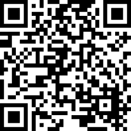
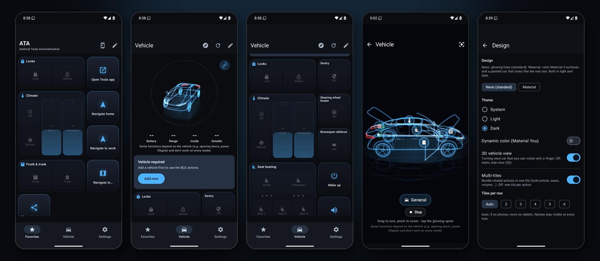
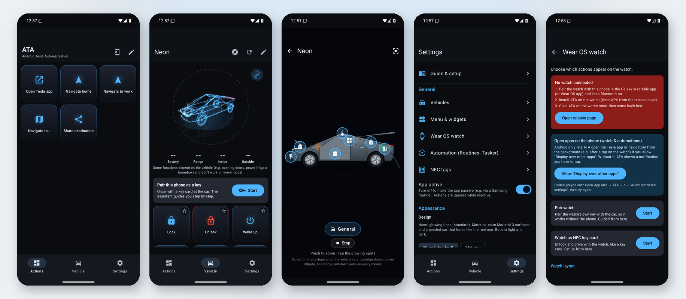
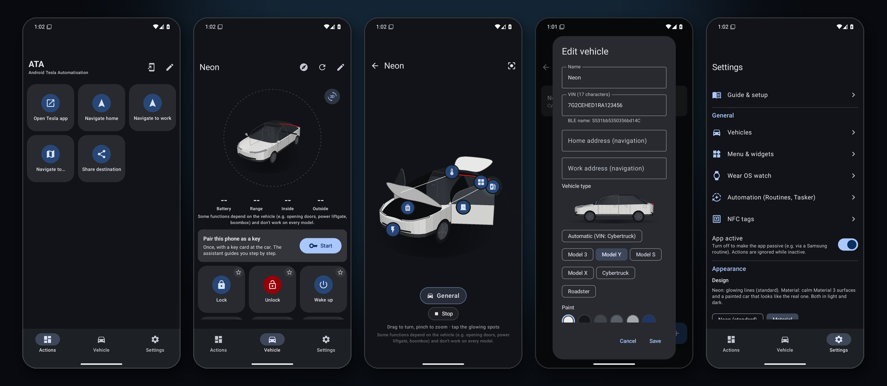
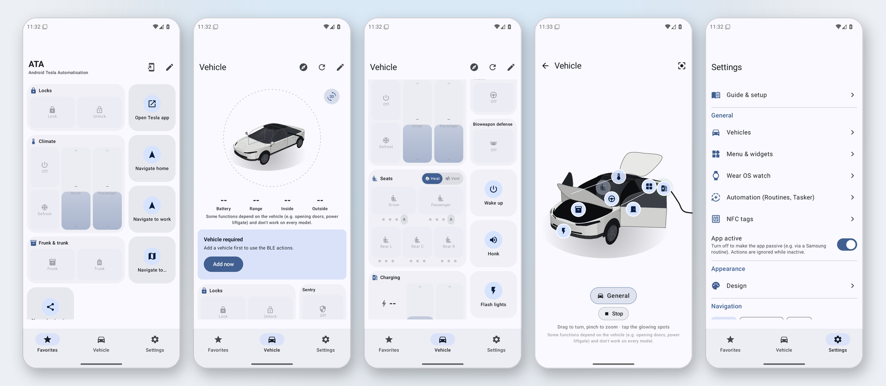
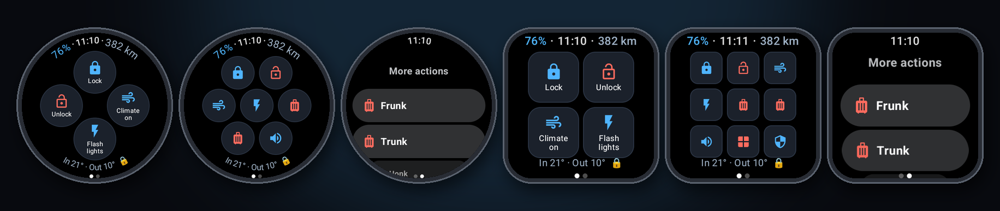

# ATA — Android Tesla Automatisation

ATA turns your phone and watch into a fast remote and automation hub for your Tesla.
It is built for **shortcuts, Samsung routines, home‑screen widgets and Wear OS**, so a single
tap — or an automation — triggers exactly the action you want.

> **Not affiliated with Tesla, Inc.** "Tesla" is a trademark of Tesla, Inc.
> Use at your own risk. See [Legal](#legal).
>
> **Commercial use requires prior written permission** from the author — see [Legal](#legal).


## Support the project

ATA is free for personal use. If it saves you a few taps every day, you can support the development:

<a href="https://www.paypal.com/donate/?hosted_button_id=YHEH2ZKAV4E9Y"></a>

<a href="https://www.paypal.com/donate/?hosted_button_id=YHEH2ZKAV4E9Y"></a>

## Downloads

Latest release **v1.8.2** — phone APK for **64‑bit ARM (arm64‑v8a)**, watch APK for **64‑ and 32‑bit ARM (arm64‑v8a + armeabi‑v7a)**:

- 📱 Phone APK: **[ATA-phone-v1.8.2-arm64-v8a.apk](https://github.com/juliandaniels97/AndroidTeslaAutomatisation-ATA-/releases/download/v1.8.2/ATA-phone-v1.8.2-arm64-v8a.apk)**
- ⌚ Wear OS APK: **[ATA-wear-v1.8.2.apk](https://github.com/juliandaniels97/AndroidTeslaAutomatisation-ATA-/releases/download/v1.8.2/ATA-wear-v1.8.2.apk)**

All releases are listed under [Releases](https://github.com/juliandaniels97/AndroidTeslaAutomatisation-ATA-/releases).
All release builds are signed with the same release key, so new versions install as an update over
the old one. (Very early builds were signed with a public debug key; if ATA does not update over such a build,
uninstall it once and pair the phone with the car again.)

## Screenshots

**Neon — dark mode**



**Neon — light mode**



**Material — dark mode**



**Material — light mode**



**Wear OS**



## Requirements

| | Phone | Watch |
|---|---|---|
| OS | Android 12+ (minSdk 31, targets Android 17 / API 37) | Wear OS 3+ (Galaxy Watch 4 and newer, minSdk 30, targets API 37) |
| CPU | arm64‑v8a | arm64‑v8a or armeabi‑v7a (32‑bit, e.g. Galaxy Watch 6) — one APK for both |
| Needs the phone? | — | Relays to the phone by default, or **direct control** over BLE once the watch is paired |

## Two feature sets, one app

ATA groups everything into the **Basic features** (navigation & app links) and the **BLE features**
(direct Bluetooth control). Both work **without a Tesla account in ATA, without the Fleet API and
without any cloud connection** — which is also gentle on the car's battery, because nothing keeps
polling the vehicle over the internet.

### Basic features — routing & app links

- **Open the Tesla app** or jump toward its sections (Charging, Climate, Controls, Location).
- **Navigate**: send *Home*, *Work* or any address to Google Maps, Waze or the system handler.
- **Share a destination** via the Android share sheet.

> Deep links into specific Tesla‑app sections (Charging, Climate, …) are **not** officially
> supported by Tesla — only opening the app is guaranteed. ATA tries several candidate links and, if
> none is handled by the installed Tesla‑app version, simply opens the app on its main screen.

### BLE features — direct control over Bluetooth

The BLE features talk **directly to the car over Bluetooth Low Energy** using Tesla's publicly
documented vehicle‑command protocol. The cryptographic layer (ECDH key agreement, HMAC session
verification, AES‑GCM command signing, metadata serialization) is implemented from that spec and
**verified byte‑for‑byte against Tesla's published test vectors**.

They are **off by default**. Enable them under **Settings → Bluetooth & NFC → Direct BLE control**.
Some functions are **vehicle‑specific** (e.g. opening single doors, the power liftgate or the boombox)
and don't work on every model. Then:

1. Add your vehicle (VIN) under **Settings → Vehicles**.
2. On the **Vehicle** tab, tap **Pair this device**. On the first connection the car asks to trust
   this device's key — compare the fingerprint shown in ATA, tap your key card on the console and
   confirm in the car. ATA's key is an EC‑P‑256 key kept in the Android Keystore and never leaves
   the phone.
3. The BLE buttons then send commands over BLE: lock/unlock, open driver or passenger door, climate
   (on/off, temperature, keeper/dog/camp, defrost, steering‑wheel heater, bioweapon defence, cabin
   overheat protection), charging (start/stop, limit, amps, charge port), trunk/frunk, windows,
   sentry, honk, flash, wake, remote drive, media (play/pause, next, previous) and the boombox (fart
   and locate sound).

#### Live status

With the BLE features enabled, ATA can read the car's **battery, range, inside/outside temperature,
charging and lock state** over BLE. Pull the latest reading any time with the **refresh** button on
the Vehicle tab, or let ATA poll automatically on the interval you choose under **Settings → Status
interval** (15 min minimum; `Off` disables it). **Background polls never wake the car:** ATA first
asks the security controller (which stays awake) and, if the car sleeps, only refreshes the lock state
and keeps battery/range from the last reading ("car asleep" is shown). Only the manual refresh wakes
the car. Polling only runs while the BLE features are on, the app is **active**, a vehicle is selected
and Bluetooth permission is granted.
The last snapshot is cached on device and shown on the Vehicle tab, the status widget, the watch and
its complications, with a relative "updated X ago" timestamp.

## Design

Choose under **Settings → Appearance → Design**, each in light and dark:

- **Neon (standard):** glowing lines on a dark showroom, a neon car with a floor reflection.
- **Material:** calm Material 3 surfaces, flat tonal tiles, and a **painted car close to the real one**:
  black glass roof, dark windows, black rocker panels and bumpers, dark aero wheels, light strips and a
  clear‑coat sheen when it turns. Doors and lids open as painted panels; the effects use Material
  colours without glow.

## Vehicle view

The Vehicle tab shows your car inside a **battery ring** (dark blue 100–80 %, blue 80–20 %, yellow
20–10 %, red below 10 %, with a subtle animated glow).

- **Six body styles:** Model 3, Model Y, Model S, Model X, Cybertruck and Roadster. ATA picks the
  style from the VIN; you can override it under **Settings → Vehicles → Edit** (with a live preview).
  The steering wheel, driver door and charge port sit on the left (left‑hand drive).
- **Colour per vehicle:** a Tesla paint for the Material design (Pearl White, Solid Black, Stealth Grey,
  Midnight Silver, Quicksilver, Deep Blue, Ultra Red, Stainless) and a line colour for the neon design.
- **3D (default):** a minimalist neon car that turns slowly, with rims, mirrors, door handles, seats,
  the battery pack in the floor (cells light up with the charge level) and a reflection on the floor.
  Tap it for the **full‑screen view**: turn it with one finger (it follows the finger), **pinch to zoom**, and tap the glowing
  spots on the car (doors, frunk, trunk, charge port, windows, lights, climate) to run actions right
  there.
- **2D:** switch off **Settings → Appearance → 3D vehicle view** for a calm, solid side view of your
  car instead.
- **Animations after each action:** doors swing open, lids lift, the charge port opens and the cable
  plugs in with flowing energy, windows go down, lights flash, wake lights up the light bars, unlock
  lights the door handles and puddle lights, mirrors fold when locking, air flows from the vents,
  music shows an equaliser, sentry sweeps a red radar beam, remote drive spins the wheels, bioweapon
  defence surrounds the car (not the cabin) with green fog. **Show animations** in the full‑screen view
  plays them all without sending anything to the car.

## Security

ATA can open your car, so every request is checked by one policy (`ActionPolicy`) before it runs.
The trust level comes **only** from ATA's own per‑install token — never from what the caller claims:

| Who triggers | Basic actions | BLE, non‑critical (climate, charging, lock …) | BLE, critical (unlock, trunk, frunk, charge port open, vent windows, sentry off) |
|---|---|---|---|
| ATA app (tap) | ✅ | ✅ | ✅ after confirmation (+ biometrics if enabled) |
| **ATA shortcuts, widgets, Samsung Routines, Tasker with token** | ✅ | ✅ — also while the phone is locked (switchable) | Notification **"Run …?"** → tap (+ biometrics if enabled). Per action you can allow it without asking (phone unlocked; optionally also locked) |
| ATA watch app | ✅ | ✅ | ✅ after a confirming second tap on the unlocked watch |
| NFC tag written by ATA | ✅ | ✅ | always asks via notification |
| Other apps, links, foreign tags (no token) | ✅ | only actions you allow under **Settings → Automation**, phone unlocked | ❌ never |

- The BLE features stay off until you turn them on under **Settings → Bluetooth & NFC**, and
  automations only run while ATA is **active**.
- There is no web‑link (`BROWSABLE`) entry point, so a web page can't trigger commands.
- **Settings → Automation** shows the token (copy it into Tasker), renews it (ATA re‑issues its own
  shortcuts and widgets) and can invalidate all NFC tags at once.
- The NFC key card only answers while the phone is **unlocked** (a locked phone could otherwise be
  relayed to the car).

## Automation

### Samsung Routines (recommended)

> ⚠️ **Which actions can a routine run?** Samsung Routines only offers the **app shortcuts** ATA
> publishes: the **4 actions of the icon menu** (Settings → *Menu & widgets*) plus the extra
> **routine actions** you tick under Settings → *Menu & widgets* → *Samsung Routines* (up to about 11
> more, depending on the device). Actions that need a value (address, charge limit …) can't be used
> in routines. If an extra action doesn't appear in Routines on your device, only the 4 icon‑menu
> actions work there — put the ones you need into the icon menu.

Samsung Routines starts **app shortcuts**, and ATA's shortcuts carry the token, so routines are
trusted:

1. Choose the actions under Settings → *Menu & widgets*: up to 4 in the **icon menu** and more under
   **Samsung Routines**.
2. In the routine, add the action **Open an app / app shortcut**, pick ATA and the action.
3. For **ATA active / passive** there are shortcuts too (*ATA active*, *ATA passive* in the shortcut
   picker) — routines can't send broadcasts.

What happens when the routine runs:
- **Non‑critical BLE actions** (climate, charging, lock, sentry on …) run right away, even with the
  phone locked in your pocket, and a notification shows the result ("Climate on ✓" or the reason it
  failed).
- **Critical actions** (unlock, trunk, frunk, charge port, vent windows, sentry off) post a
  notification **"Run Unlock?"** — one tap (and biometrics if enabled) and it runs. To run one without
  asking, tick it under **Settings → Automation → Critical actions**.
- **Basic actions** (navigate, open the Tesla app) open immediately when the routine starts the
  shortcut; with a delay, ATA posts a "tap to open" notification because Android doesn't let
  background apps open other apps.
- Allow notifications for ATA (Settings → Automation shows a button) so you see results and
  confirmations.

### Home‑screen shortcuts, app‑icon menu, widgets
Any action can be pinned to the launcher; long‑pressing the ATA icon shows up to **4 configurable
actions**. All of them carry the token and behave like Samsung Routines above.

### Tasker & broadcasts
```
Action:  org.tfv.ata.action.RUN
Extras:  action_id   = e.g. "climate_on" | "navigate_home" | "charge_limit"
         token       = your ATA token (Settings → Automation → Copy)
         value       = optional (address, charge limit 50–100, amps 1–48, temperature 15–28)
         vehicle_id  = optional
         delay_ms    = optional delay (up to 6 h, approximate)
```
Without `token`, a broadcast counts as an other app (see [Security](#security)). Instead of the
broadcast you can also use Tasker's *App shortcut* action with an **ATA shortcut**.

```
Action:  org.tfv.ata.action.SET_ACTIVE      Extras: active = true | false, token = your ATA token
```

**Status as a trigger** (opt‑in, Settings → Automation → *Send status broadcast*): after each status
poll ATA sends

```
Action:  org.tfv.ata.action.STATUS
Extras:  battery_percent (int), range_km (int), charging (bool), locked (bool, omitted if unknown),
         climate_on (bool), inside_temp_c (float), outside_temp_c (float), vehicle_id (string)
```
Every app on the phone can read this broadcast, so it is off by default.

BLE commands run in a short foreground service (or a background job when Android doesn't allow the
service), so they also work while the phone is in your pocket.

### Widgets
- **Status:** battery (with bar), range, inside and outside temperature, charging and lock state.
  Responsive from 1×1 to 4×2 — every size shows every value, only arranged differently.
- **Actions:** the actions chosen in Settings → *Menu & widgets* (Basic and BLE).
- **Find my car:** distance and direction to where the car was last reached over Bluetooth.

## Wear OS

The watch app (separate APK) controls the car from your wrist:

- **Big tiles with icons** on the first screen. Round watches arrange them honeycomb‑style in rows of
  **1/2/1** (4 tiles) or **2/3/2** (7 tiles), square watches as **2×2** or **3×3**. Choose 4 or 7 (9)
  under **Settings → Wear OS watch → Watch layout** on the phone; the first actions you picked become
  tiles.
- **Swipe left** for all other actions as a list, plus direct control, the NFC key card and pairing.
- **Status around the edge:** battery and range next to the time, inside/outside temperature and lock
  state along the bottom of the rim.
- **Complications for any watch face:** each status value is its own source (*ATA battery* — also
  as a ring —, *ATA range*, *ATA inside/outside temperature*, *ATA lock state*), plus four action
  slots *ATA action 1–4* whose actions you choose on the phone (**Settings → Wear OS watch →
  Watch‑face complications**). Critical actions ask for a confirming tap.
- A **tile** for the tile carousel.

- **Relay mode (default):** tapping a chip sends the action to the phone running ATA, which performs
  it (Basic *and* BLE) and reports the result back to the watch.
- **Opening apps on the phone** (e.g. *Open Tesla app*, *Navigate home* from the watch): Android only
  lets ATA open another app from the background if you allow **"Display over other apps"** for ATA
  (Settings → *Wear OS watch* has a button). Without it, the phone shows a notification you tap to
  open the app, and the watch tells you so. If the switch is greyed out: App info → ATA → ⋮ →
  *Allow restricted settings*.
- In **direct control**, if the watch can't reach the car or isn't paired, it hands the command to
  the phone instead.
- **Critical actions** (unlock, trunk …) need a **second tap** to confirm and never run from a locked
  watch.
- **Direct control (BLE, Wear OS 4 / Android 12 or newer):** the watch can also talk to the car
  itself, without the phone in range. The phone's key is hardware‑backed and cannot be copied, so the
  watch uses **its own** key (Driver role) and is paired with the car once:
  1. On the phone, select the vehicle (Actions tab) — its VIN syncs to the watch automatically, so
     you never type a VIN on the watch.
  2. On the watch, enable **Direct control** (grants Bluetooth permission) and tap **Pair this
     watch**; confirm the new key in the car with your key card.
  3. BLE chips then run straight from the watch; Basic actions still relay to the phone.
- **Configure from the phone:** choose which actions appear on the watch under
  **Settings → Wear OS watch**; the list, the selected vehicle and the status sync automatically over
  the Wear Data Layer.

## NFC

Two independent NFC features — you can use either, both, or neither.

### NFC tags (tap‑to‑run)

**Settings → NFC tags** writes an action to an NFC tag or sticker (`ata://run?action=…`). Tapping the
phone on that tag runs the action. Tags carry a separate NFC token, so only your phone runs them,
and **Settings → Automation → Invalidate all NFC tags** revokes every tag at once. Because anyone can
read and copy a tag, critical actions from a tag (e.g. an *Unlock* tag) always ask for confirmation
first.

### Tesla key card emulation — phone *as* the card (BETA)

**Settings → Bluetooth & NFC → NFC key card** turns the phone itself into a Tesla **key card** via host
card emulation (HCE). The car's center‑console reader talks to the phone over NFC exactly as it would
to a plastic card, so no app has to be open — and it works alongside the BLE phone key, not instead
of it. It only answers while the phone is **unlocked**.

It reuses the **same hardware‑backed key** as the BLE phone key (one enrolment covers both): the
private key is generated in the Android Keystore and never leaves the secure element. The handshake is
standard Tesla VCSEC — an ECDH key agreement on the shared P‑256 key, then an `AES‑128` challenge
response — so no secret is ever stored in the app or transmitted.

**Enrol it like any card:** in the car, **Controls → Locks → Add key**, tap an already‑paired key or
phone to authorise, then hold this phone flat and still against the card reader on the center console
until the car confirms. After that, tap to lock/unlock like a card.

- **Phone must be unlocked:** a locked phone never answers the reader, so neither a lost phone nor a
  relay attack on a phone in your pocket can open (or drive) the car.
- Needs a phone with NFC + HCE (almost all modern Androids). Enabling the feature registers ATA as the
  card service; make sure no other wallet app is set to handle the Tesla card AID.

## Settings

- **Design** (Neon or Material) and **theme** (System/Light/Dark) + Material You dynamic color; **language** follows the system
  (English & German).
- **Navigation app**: Google Maps, Waze or system.
- **Confirm critical actions**, **biometric lock** (apply in the app and when confirming an
  automation).
- **Automation**: what routines, Tasker, widgets, NFC tags and other apps may run; token; status
  broadcast (see [Security](#security)).
- **Point animation to car** (optional): uses your location (permission prompted) to aim the neon
  activation animation toward the car's last‑known spot — the spot is remembered whenever a BLE
  command succeeds (i.e. when you were next to the car).
- **Active toggle** for routines; **multi‑vehicle** (name, VIN, home & work addresses).
- **Bluetooth & NFC → Direct BLE control** and **NFC key card** (phone as a Tesla key card, BETA).
- **3D vehicle view** on or off (off: solid 2D side view); vehicle **type** per vehicle.
- **Status interval**: how often ATA polls the car for a battery/range/climate snapshot over BLE
  (Off, or 15 min and up). Requires the BLE features.
- **Proximity unlock (BETA)** is reserved for an upcoming release (see known limitations) and currently has no
  effect.

## Known limitations

- **Vehicle‑specific functions** (single doors, power liftgate, boombox …) only work on cars that
  have them.
- The **NFC key card** (phone and watch) is still **BETA** and not yet verified on a real car.
- **Proximity unlock** is not implemented — the setting is a placeholder and has no effect.
- **Seat heater** has no BLE command mapped yet; the tile reports it as unavailable.
- **Samsung Routines** only lists ATA's published app shortcuts (icon menu + routine actions, see
  above); whether the extra routine actions appear depends on the One UI version.
- Delays (`delay_ms`) are approximate: Android may postpone background work by a few minutes.
- Tesla‑app section deep links are best‑effort and may just open the app on its main screen.

## Build it yourself

Requires JDK 17 and the Android SDK.

```bash
git clone https://github.com/juliandaniels97/AndroidTeslaAutomatisation-ATA-.git
cd AndroidTeslaAutomatisation-ATA-
./gradlew :app:assembleRelease :wear:assembleRelease
```

Outputs: `app/build/outputs/apk/release/` and `wear/build/outputs/apk/release/`.

| Module | Purpose |
|---|---|
| `:core` | Shared models, action catalog + policy, Basic deep links, VIN helpers, BLE protocol/crypto (unit‑tested with Tesla's vectors: `./gradlew :core:testDebugUnitTest`) |
| `:app` | Phone app (Compose UI, shortcuts, widgets, automation, Wear bridge) |
| `:wear` | Wear OS app (Compose tile grid, tile, complications) |

## Release signing

Release APKs are signed only with the real release key from four repository secrets. Without them
the CI build **fails** (and a local release build stays unsigned) — ATA never falls back to a debug
key, because an update signed with a known key could take over the paired vehicle key. With the same
key across builds, new versions install as an update over the old one. Set the secrets under
**GitHub → Settings → Secrets and variables → Actions**:

| Secret | Value |
|---|---|
| `ATA_KEYSTORE_BASE64` | your keystore (`.jks`) as base64: `base64 -w0 release-keystore.jks` |
| `ATA_KEYSTORE_PASSWORD` | keystore password |
| `ATA_KEY_ALIAS` | key alias |
| `ATA_KEY_PASSWORD` | key password |

Create a keystore once with:

```bash
keytool -genkey -v -keystore release-keystore.jks -keyalg RSA -keysize 2048 \
  -validity 10000 -alias ata
```

Keep the `.jks` file and its passwords safe and **out of git** — losing them means you can't ship
signed updates that install over an existing install.


## Legal

- Licensed under the **ATA License (Source‑Available, Non‑Commercial)** — see [LICENSE](LICENSE).
  You may use, modify and share ATA for **personal, educational and other non‑commercial purposes**.
- **Commercial use requires prior written permission** from the author
  ([github.com/juliandaniels97](https://github.com/juliandaniels97)). This includes selling it,
  bundling it into a paid or ad‑supported product or service, or otherwise using it to generate
  revenue.
- See [NOTICE](NOTICE) for third‑party attributions (Tesla vehicle‑command protocol, Apache‑2.0).
- ATA is **not affiliated with, endorsed by, or sponsored by Tesla, Inc.** "Tesla" and related
  marks are trademarks of Tesla, Inc., used only to describe interoperability.
- ATA stores your data **only on your device** and needs no account or internet of its own for its
  core features. You are responsible for complying with local laws when automating your vehicle.
